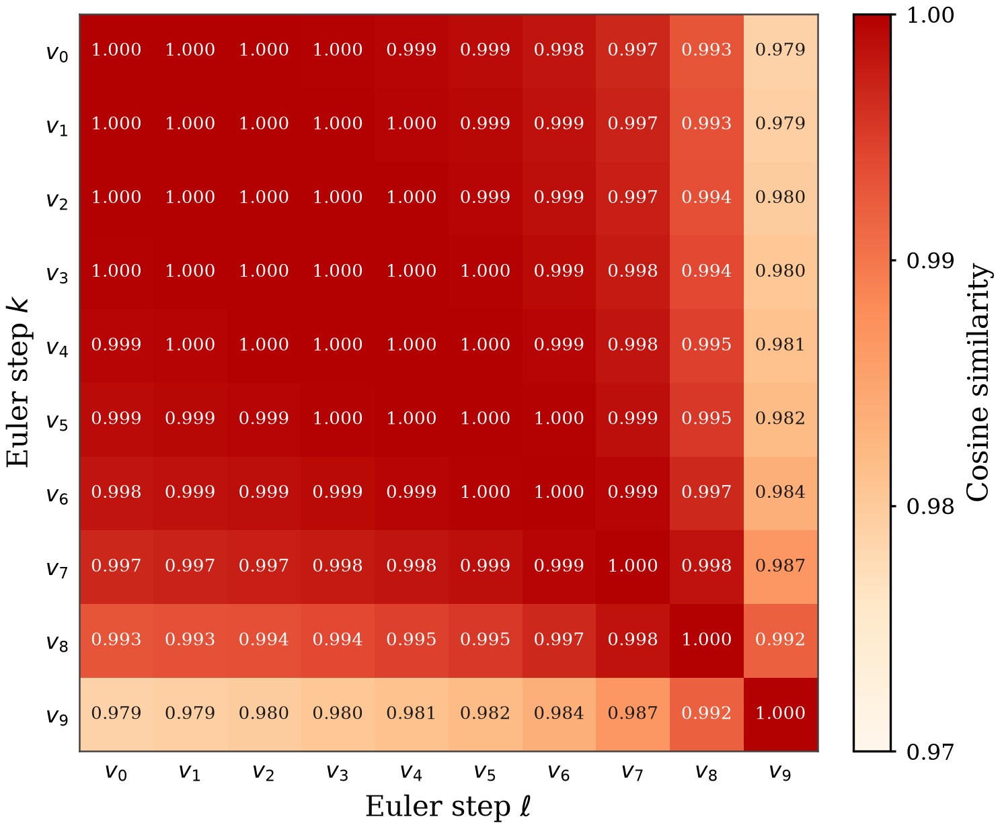
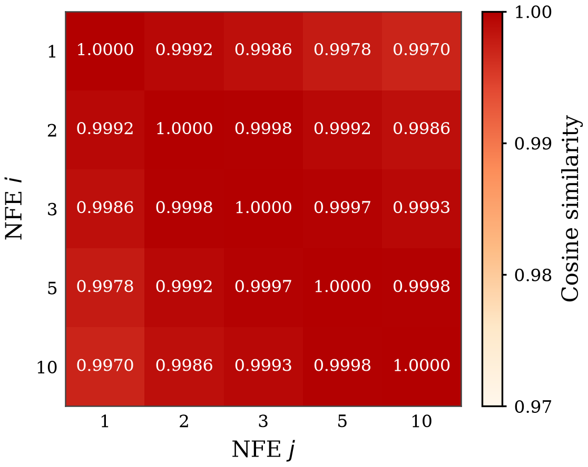

# NFE=1 closed-loop LIBERO (this machine)

NFE = Euler flow-matching steps (`policy.num_inference_steps`)。默认 10。NFE=1 是一步 Euler，不是 EfficientVLA 的隐状态缓存。动作专家是 `predict_action_chunk` 的墙钟瓶颈（π0.5 约 74%，MolmoAct2 约 90%），语言层 skip 几乎不改 chunk 时间；把专家从 10 步收到 1 步，才把整模型推理时间压下来。

论文数字只用本机。不要把 `another_server_results` 写进表。不要读闭环 `eval_s` 当效率（MuJoCo 主导 LIBERO 墙钟）。效率是 `predict_action_chunk` 的 CUDA-event 时间。

局部锚点（本机、NFE=10）：π0.5 **97.25**（400 集），MolmoAct2 **97.50**（2000 集）。0.25–0.75 Avg. 是噪声。400 集在 97% 附近的二项 SE 约 0.8 分。

通过规则：与**同一协议**的 NFE=10 比，Avg. 差在 2 分以内，且没有套件塌掉。

---

## Protocol

单进程四套件（Spatial / Object / Goal / Long=LIBERO-10），`seed=1000`，`batch_size=1`，`compile_model=false`，`n_action_steps=10`，无 recovery。NFE=1 只改 `num_inference_steps`。输出在新目录，不覆盖 NFE=10 的 `eval_info.json`。

| 栈 | 权重 | skip | 删层 | 集数 | `num_steps_wait` |
|---|---|---|---|---|---:|
| π0.5 | `lerobot/pi05_libero_finetuned_v044` | DTR Appendix B（keep prefix K/V） | full；Fisher Drop-6 `[1, 13–17]` | 每任务 10（400） | 默认 10（与本机 π0.5 历史评估相同） |
| MolmoAct2 | `allenai/MolmoAct2-LIBERO-LeRobot` 本机 `eval_ckpt` | keep-KV identity residual | full；Taylor Drop-16 `[1–4, 24–35]` | 每任务 10（400） | 50（与本机 Molmo 历史评估相同） |

π0.5 相对 `eval_pi05_libero_v044.md`：**只**把 NFE 从 10 改成 1。MolmoAct2 相对 `eval_molmoact2_libero.md`：NFE 10→1，并且这一轮按 400 集跑（历史锚点是 50 集/任务、共 2000）。Molmo 的 400 对 2000 **不是**同协议对比。

Source:

- 闭环：`results/stage_nfe/{pi05_full_nfe1,pi05_k6_fisher_nfe1,molmoact2_full_nfe1,molmoact2_drop16_taylor_nfe1}/{eval_info.json,drop_meta.json|drop.json}`
- 离线 / chunk 时间：`results/stage_nfe/{pi05,molmoact2}.json`，脚本 `scripts/stage_nfe/measure_nfe.py`
- NFE=10 锚点：`results/eval_drop/{baseline,k6_fisher}`，`results/molmoact2_libero/{baseline_eval,drop16_taylor_nol0}`

---

## 1. Closed-loop success rate (%)

NFE=10 行是本机已有锚点，不是这次重跑。NFE=1 四格都是 400 集、`EXIT:0`。

| Model | Setting | NFE | Spatial | Object | Goal | Long | Avg. | n |
|---|---|---:|---:|---:|---:|---:|---:|---:|
| π0.5 | full | 10 | 97.0 | 100.0 | 95.0 | 97.0 | 97.25 | 400 |
|  | full | 1 | 97.0 | 99.0 | 97.0 | 95.0 | **97.00** | 400 |
|  | Fisher Drop-6 | 10 | 97.0 | 100.0 | 96.0 | 98.0 | 97.75 | 400 |
|  | Fisher Drop-6 | 1 | 97.0 | 100.0 | 93.0 | 96.0 | **96.50** | 400 |
| MolmoAct2 | full | 10 | 97.4 | 99.6 | 96.8 | 96.2 | 97.50 | 2000 |
|  | full | 1 | 99.0 | 100.0 | 97.0 | 97.0 | **98.25** | 400 |
|  | Taylor Drop-16 | 10 | 98.2 | 99.4 | 98.6 | 96.2 | 98.10 | 2000 |
|  | Taylor Drop-16 | 1 | 100.0 | 99.0 | 98.0 | 100.0 | **99.25** | 400 |

Δ Avg. vs same-row NFE=10：

- π0.5 full：**−0.25**（388/400）。套件最大移动 Long −2.0、Goal +2.0。通过。
- π0.5 Fisher Drop-6：**−1.25**（386/400）。Goal 96→93（−3.0），Long −2.0，Spatial / Object 不动。Avg. 在 2 分内，没有套件塌掉。通过。
- MolmoAct2 full：400 集 98.25 vs 2000 集 97.50。协议不同，不当成同精度 Δ。四个套件都 ≥97。未塌。
- MolmoAct2 Taylor Drop-16：400 集 99.25 vs 2000 集 98.10。同样不当成同精度 Δ。四个套件都 ≥98。未塌。

语言 skip 再加 NFE=1，相对完整模型 NFE=10：

| Model | Cell | vs full NFE=10 |
|---|---|---|
| π0.5 | Fisher Drop-6 × NFE=1 | 96.50 vs 97.25（**−0.75**） |
| MolmoAct2 | Taylor Drop-16 × NFE=1 | 99.25（400） vs 97.50（2000）；协议不同 |

π0.5 这一格是同协议、可进论文的联合数字。Molmo 联合格先用 400 集表明没有塌；若要把 Molmo NFE=1 写成与 97.50 / 98.10 同精度的表，需要再跑 2000 集。π0.5 的 2000 集重评在 §7。

---

## 2. `predict_action_chunk` (this machine)

RTX 3090，`compile_model=false`，CUDA events warmup=5 / repeats=20，同一帧观测、同一推理噪声。不要和闭环 `eval_s` 混用。Drop-6 / Drop-16 的 NFE=10 FLOPs 与 `efficientcy_analysis.md` 一致。

| Setting | NFE | Time (ms) | vs full NFE=10 | FLOPs (G) | vs full NFE=10 |
|---|---:|---:|---:|---:|---:|
| π0.5 full | 10 | 548.5 | — | 5024.4 | — |
| π0.5 full | 1 | 186.7 | −66.0% | 4674.4 | −7.0% |
| π0.5 Fisher Drop-6 | 10 | 525.5 | −4.2% | 3711.6 | −26.1% |
| π0.5 Fisher Drop-6 | 1 | 160.1 | **−70.8%** | 3361.6 | **−33.1%** |
| MolmoAct2 full | 10 | 1166.4 | — | 5250.6 | — |
| MolmoAct2 full | 1 | 254.0 | −78.2% | 5176.7 | −1.4% |
| MolmoAct2 Taylor Drop-16 | 10 | 1165.2 | −0.1% | 4043.3 | −23.0% |
| MolmoAct2 Taylor Drop-16 | 1 | 246.9 | **−78.8%** | 3969.3 | **−24.4%** |

专家单独：π0.5 403.1 → 40.2 ms（−90.0%，FLOPs 388.9 → 38.9 G）；MolmoAct2 1022.8 → 103.7 ms（−89.9%，FLOPs 82.1 → 8.2 G）。语言 skip 主要减 FLOPs；NFE=1 主要减墙钟。两件事叠在 Drop-6 / Drop-16 × NFE=1 上。

---

## 3. Offline action check

NFE=10 对自己重放是精确的（`max_abs=0`）。NFE=1 用同一噪声，前 10 个执行步会动。

| Setting | replay max abs | NFE=1 vs NFE=10 L2 |
|---|---:|---:|
| π0.5 full | 0 | 0.662 |
| π0.5 Fisher Drop-6 | 0 | 1.110 |
| MolmoAct2 full | 0 | 0.103 |
| MolmoAct2 Taylor Drop-16 | 0 | 0.677 |

---

## Checks

四格都写了 `eval_info.json`，`n_episodes=400`（40 任务 × 10），`pc_success` 与 `per_group` 成功位一致，日志 `EXIT:0`。

| Cell | GPU | Drop | bits | eval_s |
|---|---|---|---|---:|
| `pi05_full_nfe1` | 0 | [] | 388/400 | 1.19 h |
| `pi05_k6_fisher_nfe1` | 1 | `[1, 13, 14, 15, 16, 17]` | 386/400 | 1.20 h |
| `molmoact2_full_nfe1` | 2 | [] | 393/400 | 1.91 h |
| `molmoact2_drop16_taylor_nfe1` | 3 | `[1, 2, 3, 4, 24–35]` | 397/400 | 1.83 h |

`num_inference_steps=1` 写在 π0.5 `drop_meta.json` 和 Molmo `drop.json`，并出现在 Molmo 评测日志的 config dump 里。π0.5 命令行带 `--policy.num_inference_steps=1`；历史 PROTO 不传该字段，默认 10。

未改 CARE / LEDGE 的 Table 1/2，也未改 `eval_pi05_libero_v044.md` / `eval_molmoact2_libero.md` 的 NFE=10 行。

---

## 4. SmolVLA NFE

Same machine, same protocol as `eval_smolvla_libero.md` except `num_steps`. `lerobot/smolvla_libero`, keep-KV, `n_action_steps=10`, `chunk_size=50`, `seed=1000`, `empty_cameras=0`, camera rename `image→camera1` / `image2→camera2`, state dim 8. Four suites × 10 tasks × 10 episodes. Taylor Drop-4 is `[12, 13, 14, 15]`. NFE=1 ran one job per GPU. NFE=2 ran both jobs together on GPU0. New directories; the NFE=10 rows 83.00 / 78.50 are not overwritten.

Source: `results/stage_nfe/smolvla_{full,drop4_taylor}_nfe{1,2,3}/` plus `*_nfe1_paired`. All `EXIT:0`. Paired rows shared a GPU with the NFE=3 job of the same model.

| Setting | NFE | Spatial | Object | Goal | Long | Avg. | bits |
|---|---:|---:|---:|---:|---:|---:|---:|
| Full | 10 | 78.0 | 89.0 | 89.0 | 76.0 | 83.00 | 332/400 |
| Full | 3 | 78.0 | 89.0 | 86.0 | 71.0 | **81.00** | 324/400 |
| Full | 2 | 77.0 | 89.0 | 88.0 | 74.0 | **82.00** | 328/400 |
| Full | 1 | 75.0 | 88.0 | 88.0 | 66.0 | **79.25** | 317/400 |
| Full | 1 paired | 76.0 | 86.0 | 84.0 | 67.0 | **78.25** | 313/400 |
| Taylor Drop-4 | 10 | 72.0 | 88.0 | 84.0 | 70.0 | 78.50 | 314/400 |
| Taylor Drop-4 | 3 | 70.0 | 89.0 | 81.0 | 64.0 | **76.00** | 304/400 |
| Taylor Drop-4 | 2 | 77.0 | 92.0 | 79.0 | 60.0 | **77.00** | 308/400 |
| Taylor Drop-4 | 1 | 72.0 | 87.0 | 75.0 | 58.0 | **73.00** | 292/400 |
| Taylor Drop-4 | 1 paired | 63.0 | 87.0 | 71.0 | 60.0 | **70.25** | 281/400 |

Full NFE=3 is **−2.00** vs 83.00. Long is 76→71. Full NFE=2 is **−1.00**, suites move by at most 2 points. Full NFE=1 is **−3.75**, Long 76→66. The paired NFE=1 rerun (same GPU as NFE=3) is 78.25, **−1.00** vs the solo 79.25.

Drop-4 NFE=3 is **−2.50** vs 78.50, Long 70→64. Drop-4 NFE=2 is **−1.50** on average, Long 70→60. Drop-4 NFE=1 is **−5.50**. The paired NFE=1 rerun is 70.25, **−2.75** vs the solo 73.00; Spatial 72→63.

400 episodes at ~80% have binomial SE ≈ 1.9 points. Full NFE=2 sits inside that. Full NFE=3 is at the edge and Long moves 5 points. Full NFE=1 does not hold. Drop-4 does not hold at NFE=1, and NFE=2/3 still give up Long. Sharing one GPU moved the full-model NFE=1 rerun by 1 point and the Drop-4 rerun by 2.75. SmolVLA stays out of the operating-point efficiency table.

---

## 5. π0.5 Fisher Drop-8 × NFE=5

Fisher Drop-8 is `[1, 2, 3, 13–17]`, NFE=10 anchor **85.50** (342/400). NFE=5 finished `EXIT:0`: Spatial 90.0 / Object 90.0 / Goal 74.0 / Long 90.0, **86.00** (344/400). Goal stays at 74, the same cliff as NFE=10 (73), NFE=1 (76) and NFE=2 (71). Fewer Euler steps do not put Drop-8 back on the plateau.

---

## 6. Paper: cosine redundancy of the π0.5 action expert

These two matrices are the Stage-4 geometric evidence. They go in the paper; the \(x_t\) path and expert-suffix hidden cosine do not (see §6.4).

Protocol: baseline π0.5 (`lerobot/pi05_libero_finetuned_v044`), no layer drop, 64 calibration frames, seed 1000, cosine on the first 10 executed steps × 7 unpadded LIBERO dims, mean over frames. \(v_k\) is the `denoise_step` velocity at Euler step \(k\) of a 10-step path (\(t=1-k/10\)). Independent NFE uses \(\mathrm{d}t=-1/\mathrm{NFE}\) from the same frozen noise; it is **not** early-stop of the 10-step path. Source: `results/stage_nfe/nfe_cosine_pi05.json`. Figures: `main_results/figures/nfe_cosine_{velocity,action,pair}.{pdf,png}` (color scale shared, truncated to \([0.97,1.00]\) because every paper entry is above 0.97). Regenerator: `scripts/stage_nfe/plot_nfe_cosine.py`.

| quantity | value |
|---|---|
| mean adjacent velocity \(\cos(v_k,v_{k+1})\) | **0.9988** |
| mean off-diagonal velocity | 0.9950 |
| first vs last velocity \(\cos(v_0,v_9)\) | **0.9789** |
| independent NFE=1 vs NFE=10 action | **0.9970** |
| independent NFE=2 / 3 / 5 vs NFE=10 action | 0.9986 / 0.9993 / 0.9998 |
| mean off-diagonal independent-NFE action | 0.9989 |
| min independent-NFE action (NFE=1 vs 10) | 0.9970 |

### 6.1 Velocity field along the 10-step Euler path

\(\cos(v_k, v_\ell)\). Adjacent steps sit at 0.999; the largest gap is the first versus last step (0.979). The last step is slightly less aligned with the rest, and the rest of the map is essentially constant. This is the nearly-straight flow: one Euler step from \(t=1\) already points in the same direction as the ten-step integral.

|  | \(v_0\) | \(v_1\) | \(v_2\) | \(v_3\) | \(v_4\) | \(v_5\) | \(v_6\) | \(v_7\) | \(v_8\) | \(v_9\) |
|---|---:|---:|---:|---:|---:|---:|---:|---:|---:|---:|
| \(v_0\) | 1.000 | 1.000 | 1.000 | 1.000 | 0.999 | 0.999 | 0.998 | 0.997 | 0.993 | **0.979** |
| \(v_1\) | 1.000 | 1.000 | 1.000 | 1.000 | 1.000 | 0.999 | 0.999 | 0.997 | 0.993 | 0.979 |
| \(v_2\) | 1.000 | 1.000 | 1.000 | 1.000 | 1.000 | 0.999 | 0.999 | 0.997 | 0.994 | 0.980 |
| \(v_3\) | 1.000 | 1.000 | 1.000 | 1.000 | 1.000 | 1.000 | 0.999 | 0.998 | 0.994 | 0.980 |
| \(v_4\) | 0.999 | 1.000 | 1.000 | 1.000 | 1.000 | 1.000 | 0.999 | 0.998 | 0.995 | 0.981 |
| \(v_5\) | 0.999 | 0.999 | 0.999 | 1.000 | 1.000 | 1.000 | 1.000 | 0.999 | 0.995 | 0.982 |
| \(v_6\) | 0.998 | 0.999 | 0.999 | 0.999 | 0.999 | 1.000 | 1.000 | 0.999 | 0.997 | 0.984 |
| \(v_7\) | 0.997 | 0.997 | 0.997 | 0.998 | 0.998 | 0.999 | 0.999 | 1.000 | 0.998 | 0.987 |
| \(v_8\) | 0.993 | 0.993 | 0.994 | 0.994 | 0.995 | 0.995 | 0.997 | 0.998 | 1.000 | 0.992 |
| \(v_9\) | **0.979** | 0.979 | 0.980 | 0.980 | 0.981 | 0.982 | 0.984 | 0.987 | 0.992 | 1.000 |

Figure: `figures/nfe_cosine_velocity.pdf`.

### 6.2 Independent-NFE final actions

Pairwise cosine of the executed action chunk under independent Euler schedules \(\mathrm{NFE}\in\{1,2,3,5,10\}\). NFE=1 already matches NFE=10 at **0.9970**; every pair is at least that high. This is the quantity that corresponds to changing `num_inference_steps`, not to truncating a 10-step trajectory.

| NFE | 1 | 2 | 3 | 5 | 10 |
|---:|---:|---:|---:|---:|---:|
| 1 | 1.0000 | 0.9992 | 0.9986 | 0.9978 | **0.9970** |
| 2 | 0.9992 | 1.0000 | 0.9998 | 0.9992 | 0.9986 |
| 3 | 0.9986 | 0.9998 | 1.0000 | 0.9997 | 0.9993 |
| 5 | 0.9978 | 0.9992 | 0.9997 | 1.0000 | 0.9998 |
| 10 | **0.9970** | 0.9986 | 0.9993 | 0.9998 | 1.0000 |

Figure: `figures/nfe_cosine_action.pdf`. Combined two-panel: `figures/nfe_cosine_pair.pdf`.

Suggested caption:

> **Cosine redundancy of the π0.5 action expert** (LIBERO calibration, 64 frames). **(a)** Velocity \(v_k\) along one 10-step Euler path (\(t=1-k/10\)). Adjacent steps average 0.999; first vs last remains 0.979. **(b)** Final executed action under independent NFE schedules (\(\mathrm{d}t=-1/\mathrm{NFE}\)). NFE=1 matches NFE=10 at 0.997. Color scale is truncated to \([0.97, 1.00]\). Cosine uses the first 10 executed steps × 7 action dims.

### 6.3 What these figures are not

Do **not** put the following in the paper as NFE-cut evidence:

- Adjacent ODE-state cosine \(\cos(x_k,x_{k+1})=0.9869\): small-\(\mathrm{d}t\) tautology.
- Noise vs action \(\cos(x_0,x_{10})=0.017\); one 10-step increment vs action \(\cos(x_1,x_{10})=0.127\): early-stop of the 10-step path is not NFE=1.
- Expert-suffix hidden cosine (adjacent 0.995, first vs last 0.777): EfficientVLA-style feature cache, not fewer Euler steps.

---

## 7. π0.5 2000-episode closed-loop

Same protocol as §1 except `--eval.n_episodes=50`（40 任务 × 50 = 2000）。`seed=1000`，单进程，`compile_model=false`。新目录，不覆盖 400 集的 `eval_info.json`。下表三格与 §7.1 的复跑都是 `EXIT:0`。2000 集在 97% 附近的二项 SE 约 0.4 分；单个套件 500 集约 0.8 分。

Source: `results/stage_nfe/{pi05_full_nfe10_2000,pi05_k6_fisher_nfe10_2000,pi05_k6_fisher_nfe1_2000}/`。复跑在 `pi05_k6_fisher_nfe1_2000_r2/`（§7.1）。视觉 k=2 的 2000 集在 `eval_pi05_vision_module_libero.md` §7，视觉 k=4 在该文件 §8。

| Setting | NFE | Spatial | Object | Goal | Long | Avg. | bits | eval_s |
|---|---:|---:|---:|---:|---:|---:|---:|---:|
| full | 10 | 97.0 | 99.4 | 97.0 | 93.8 | **96.80** | 1936/2000 | 9.81 h |
| Fisher Drop-6 `[1, 13–17]` | 10 | 98.4 | 99.4 | 95.4 | 95.2 | **97.10** | 1942/2000 | 9.90 h |
| Fisher Drop-6 `[1, 13–17]` | 1 | 97.8 | 99.6 | 92.4 | 93.0 | **95.70** | 1914/2000 | 6.34 h |

相对各自 400 集行：full NFE=10 是 97.25→96.80（**−0.45**），Long 97.0→93.8；Drop-6 NFE=10 是 97.75→97.10（**−0.65**）；Drop-6 NFE=1 是 96.50→95.70（**−0.80**）。Long 在 2000 集上都低于 400 集那一行，幅度 3 分左右，大于平均分的移动。

同一 2000 集协议：

- Drop-6 NFE=10 vs full NFE=10：97.10 vs 96.80（**+0.30**）。语言 skip 仍然不掉点。
- Drop-6 NFE=1 vs Drop-6 NFE=10：95.70 vs 97.10（**−1.40**）。Goal 95.4→92.4，Long 95.2→93.0。Avg. 在 2 分内，没有套件塌掉。通过。
- Drop-6 NFE=1 vs full NFE=10：95.70 vs 96.80（**−1.10**）。这是 2000 集上的经营点成功率。

400 集表（§1）不改。若论文改用与 Molmo 相同的 2000 集协议，π0.5 完整锚点用 **96.80**。经营点 Drop-6×NFE=1 先跑的一格仍是 **95.70**；同配置复跑是 **96.25**（§7.1）。两格都保留，不互相覆盖。

### 7.1 Drop-6 × NFE=1 复跑（2026-10-09，`EXIT:0`）

同一层集 `[1, 13–17]`，`num_inference_steps=1`，`n_episodes=50`，`seed=1000`，`compile_model=false`。目录 `results/stage_nfe/pi05_k6_fisher_nfe1_2000_r2/`，不覆盖 `pi05_k6_fisher_nfe1_2000/`。`eval_info.json`：`n_episodes=2000`，`pc_success=96.25`，`eval_s=35203`（9.78 h）。墙钟长于先跑的 6.34 h。同一波的视觉 k=4 也是 9.82 h，不拿这两次墙钟比速度。

| Setting | NFE | Spatial | Object | Goal | Long | Avg. | bits | eval_s |
|---|---:|---:|---:|---:|---:|---:|---:|---:|
| Fisher Drop-6，先跑 | 1 | 97.8 | 99.6 | 92.4 | 93.0 | **95.70** | 1914/2000 | 6.34 h |
| Fisher Drop-6，复跑 | 1 | 98.2 | 99.6 | 92.8 | 94.4 | **96.25** | 1925/2000 | 9.78 h |

复跑相对先跑 **+0.55**（Spatial +0.4，Object 持平，Goal +0.4，Long +1.4）。差在 2000 集 SE（约 0.4）的一到两倍里，四个套件都没有离开先跑的位置。相对完整模型 2000 集 NFE=10（96.80）是 **−0.55**，相对 Drop-6 NFE=10（97.10）是 **−0.85**。两轮都落在 95.7–96.3。这是波动性检查，不把 96.25 写成相对 95.70 的提升，也不替换上表那一行。

### 7.2 MolmoAct2 2000-episode NFE=1（2026-10-09，`EXIT:0`）

`scripts/stage_nfe/run_molmo_nfe1.py`，`MOLMO_N_EPISODES=50`，`seed=1000`，`enable_inference_cuda_graph=false`，`num_steps_wait=50`。目录：

- Full：`results/stage_nfe/molmoact2_full_nfe1_2000/` → **1956/2000**（97.4 / 99.4 / 97.4 / 97.0%），`eval_s` ≈ 13.9 h。
- Taylor Drop-16 `[1–4, 24–35]`：`results/stage_nfe/molmoact2_drop16_taylor_nfe1_2000/` → **1952/2000**（97.8 / 98.6 / 96.8 / 97.2%），`eval_s` ≈ 14.0 h。

`drop.json` 写明 `operator=keep_kv_identity_residual`、`num_inference_steps=1`；**不能**仅凭该字符串区分历史 keep-KV 与后续 K/V-only 源码。启动日志时间为 2026-10-09 01:31 UTC；当时导入的 `layer_skip.py` 版本无提交哈希记录，算子与源码对应见 `results/registry/core_results_registry.md`（推断项）。

相对同协议 NFE=10 锚点（`eval_molmoact2_libero.md`）：Full 97.50→97.80（**+0.30**）；Drop-16 98.10→97.60（**−0.50**）。均在 2000 集尺度上，无套件塌掉。

### 7.3 MolmoAct2 NFE=10 × 400 集闭环，GPU3 实体化 Drop-16（2026-10-15，`EXIT:0`）

`scripts/stage_nfe/run_molmo_nfe10_gpu3.sh` → `run_molmo_nfe10_closed_loop.py`。`CUDA_VISIBLE_DEVICES=3`，`seed=1000`，`per_episode_seed=true`，`batch_size=1`，`compile_model=false`，`enable_inference_cuda_graph=false`，`num_steps_wait=50`，`num_inference_steps=10`，四套件 × 10 任务 × 10 回合（400）。顺序：**Full** → **Taylor Drop-16 materialized**（`operator=keep_kv_identity_residual_then_materialize`；层 `[1, 2, 3, 4, 24–35]`，与 `eval_molmoact2_libero.md` Taylor Drop-16 no-L0 相同）。Drop-16 跑前 `preflight_molmo_nfe10_materialized.py`：`action_max_abs_vs_kvonly=0`，释放 **1531M** 参数（`preflight_materialized.json`）。不覆盖 §1 的 NFE=1 目录，也不覆盖 `molmoact2_libero/` 的 2000 集 keep-KV 锚点。

Source：`results/stage_nfe/{molmoact2_full_nfe10_400,molmoact2_drop16_materialized_nfe10_400}/{eval_info.json,run_config.json,drop.json}`；日志 `results/stage_nfe/logs_nfe10_400_gpu3/run.log`（`ALL DONE 2026-10-15T17:16:52+00:00`）。

| Setting | NFE | Spatial | Object | Goal | Long | Avg. | bits | eval_s |
|---|---:|---:|---:|---:|---:|---:|---:|---:|
| Full | 10 | 97.0 | 99.0 | 100.0 | 98.0 | **98.50** | 394/400 | 3.58 h |
| Taylor Drop-16 materialized | 10 | 99.0 | 100.0 | 99.0 | 96.0 | **98.50** | 394/400 | 3.66 h |

`overall.eval_ep_s` ≈ **32.2 s**（Full）/ **33.0 s**（Drop-16）。闭环墙钟含 LIBERO 仿真与 GPU3 叠卡，**不是** `efficiency_analysis.md` 的 chunk 测速。

Δ **同协议、同轮次**：Drop-16 materialized vs Full Avg. **0.00**（同为 394/400）；套件互有 ±2.0 pp 以内的置换（Long 98.0→96.0，Spatial 97.0→99.0），无塌缩。

对照（协议或算子不同，仅作边界参考，不写入 §1 主表）：

- vs §1 同机 Full **NFE=1** 400 集（98.25）：本格 Full NFE=10 **+0.25**。
- vs §1 同机 keep-KV Taylor Drop-16 **NFE=1** 400 集（99.25）：不同 NFE，不比 Δ。
- vs `eval_molmoact2_libero.md` keep-KV Taylor Drop-16 **NFE=10** 2000 集（98.10）：本格 materialized 400 集 **+0.40** pp Avg.，但 400 vs 2000 且 hook vs materialize，不能当成同精度复现。

结论：在 NFE=10、400 集协议下，**实体化 Taylor Drop-16 与 Full 同成功率**；支撑 `efficiency_analysis.md` §6 的部署侧参数释放，**不**替换 `eval_molmoact2_libero.md` 的 keep-KV 2000 集主数字。

---

## Scope

π0.5 与 MolmoAct2 的 NFE=1 结论是 **LIBERO、本机单进程协议**。SmolVLA 在同一协议下不成立。另一台机器上的 RoboTwin NFE=1 掉了约 15 分（`another_server_results`），那不是本机数字，也不写入上表。MolmoAct2 2000 集 NFE=1（Full / Taylor Drop-16）见 §7.2；`drop.json` 仅记录 `operator=keep_kv_identity_residual`，与当时磁盘上的 skip 实现需对照 `results/registry/core_results_registry.md`。MolmoAct2 **NFE=10**、400 集、GPU3 **Full / materialized Drop-16** 闭环见 §7.3。π0.5 的 2000 集闭环在 §7。
