# SmolVLA CARE v2 timestamp preview

只读 CARE v2 已冻结的 480 帧校准集（`results/stage2_care_v2/shared.pt`）。
H=10，7 维示范动作按维白化后的相邻 L2 均值再除以全体均值，得到 α（均值精确为 1）。
四个套件各取 **task 0**，在该任务已有的 **12 个候选 timestamp** 内按 α 取最高、最接近中位、最低，共 12 段。
**这是候选池内排序，不是整条轨迹、也不是 480 帧全局排序。**

α 大表示该 timestamp 之后 H 步里动作变化更急；这里只客观展示，不把高 α 直接叫成「关键动作」。
数据集 FPS=**10**，窗口前后各约 1 秒（10 帧）；轨迹边界不够时在片段上标注截断。
红色虚线 = 所选 timestamp（窗口起点）。蓝点线 = 窗口内 whitened |Δa| 最大的那一步的后一帧。不要把窗口起点当成突变发生点。

未跑模型。未覆盖 `shared.pt`、分数文件和历史闭环。

## libero_spatial · task 0

Instruction: `pick up the black bowl between the plate and the ramekin and place it on the plate`

Dataset `task_index`=34. 12 CARE v2 timestamps in this task's pool.

| pick | pool rank | α | d_whitened | episode | timestamp frame | window | max-Δ frame | clip | notes |
|---|---:|---:|---:|---:|---:|---|---:|---|---|
| high | 1/12 | 3.099 | 6.345 | 1275 | 106 | [106, 115] | 114 | `spatial_task0_high/clip.mp4` | full ±1s |
| mid | 6/12 | 1.794 | 3.673 | 1282 | 11 | [11, 20] | 17 | `spatial_task0_mid/clip.mp4` | full ±1s |
| low | 12/12 | 0.867 | 1.776 | 1597 | 26 | [26, 35] | 27 | `spatial_task0_low/clip.mp4` | full ±1s |

### high — highest α in pool (rank 1/12)

- episode `1275`, timestamp frame `106` (t=10.60s), length `128`
- CARE α=`3.099`, d_whitened=`6.345`
- scoring window H=10: frames `106`–`115`
- max whitened adjacent diff **inside the window**: frame `114` (pair `113`→`114`), value `12.701`

[video](spatial_task0_high/clip.mp4) · still at max-Δ: 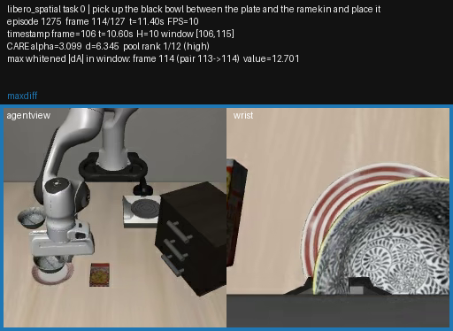

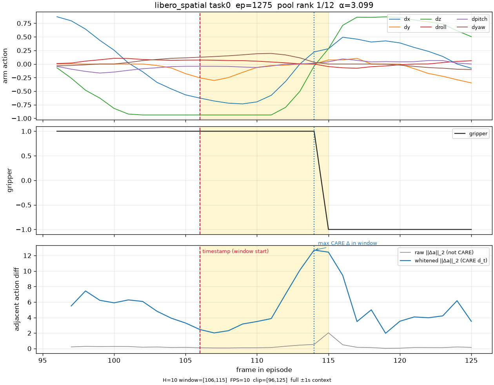

### mid — closest to pool median α (rank 6/12)

- episode `1282`, timestamp frame `11` (t=1.10s), length `84`
- CARE α=`1.794`, d_whitened=`3.673`
- scoring window H=10: frames `11`–`20`
- max whitened adjacent diff **inside the window**: frame `17` (pair `16`→`17`), value `6.449`

[video](spatial_task0_mid/clip.mp4) · still at max-Δ: 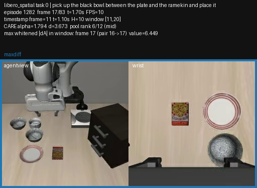

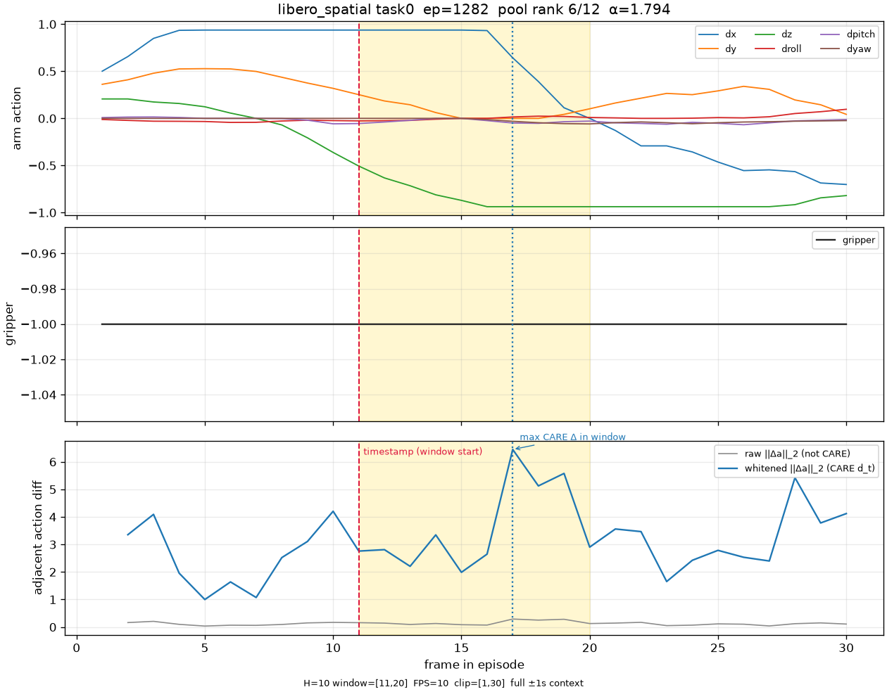

### low — lowest α in pool (rank 12/12)

- episode `1597`, timestamp frame `26` (t=2.60s), length `96`
- CARE α=`0.867`, d_whitened=`1.776`
- scoring window H=10: frames `26`–`35`
- max whitened adjacent diff **inside the window**: frame `27` (pair `26`→`27`), value `5.950`

[video](spatial_task0_low/clip.mp4) · still at max-Δ: 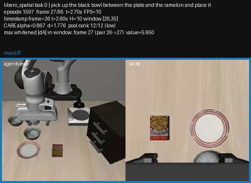

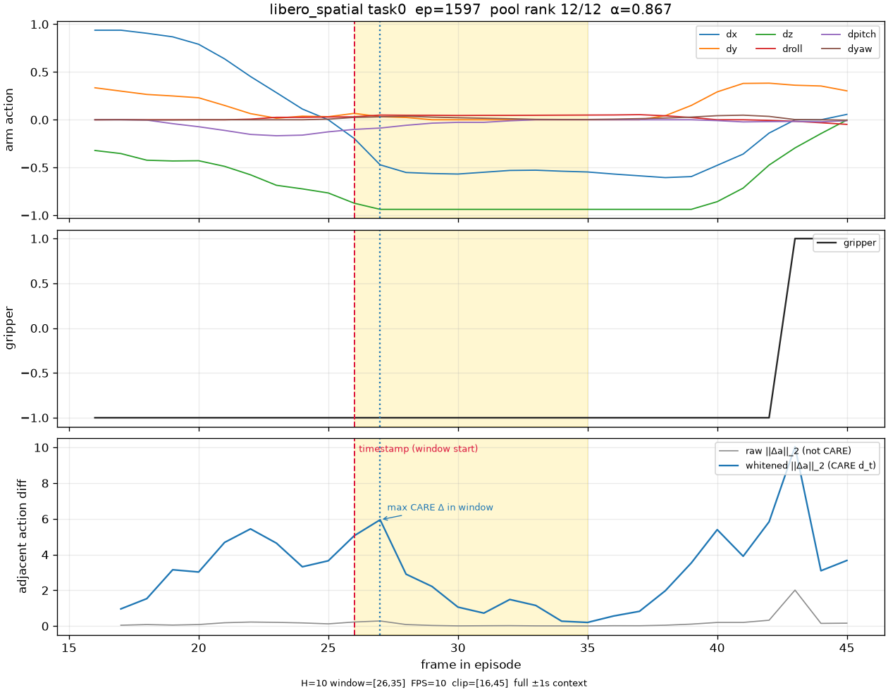

## libero_object · task 0

Instruction: `pick up the alphabet soup and place it in the basket`

Dataset `task_index`=24. 12 CARE v2 timestamps in this task's pool.

| pick | pool rank | α | d_whitened | episode | timestamp frame | window | max-Δ frame | clip | notes |
|---|---:|---:|---:|---:|---:|---|---:|---|---|
| high | 1/12 | 1.491 | 3.053 | 905 | 67 | [67, 76] | 73 | `object_task0_high/clip.mp4` | full ±1s |
| mid | 6/12 | 1.133 | 2.319 | 825 | 65 | [65, 74] | 71 | `object_task0_mid/clip.mp4` | full ±1s |
| low | 12/12 | 0.214 | 0.439 | 945 | 100 | [100, 109] | 106 | `object_task0_low/clip.mp4` | full ±1s |

### high — highest α in pool (rank 1/12)

- episode `905`, timestamp frame `67` (t=6.70s), length `154`
- CARE α=`1.491`, d_whitened=`3.053`
- scoring window H=10: frames `67`–`76`
- max whitened adjacent diff **inside the window**: frame `73` (pair `72`→`73`), value `5.082`

[video](object_task0_high/clip.mp4) · still at max-Δ: 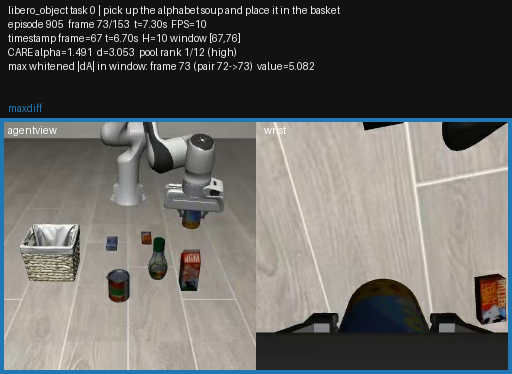

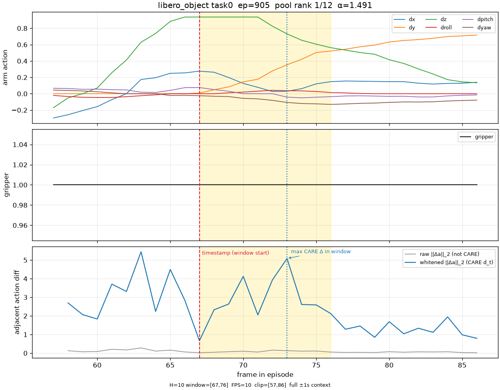

### mid — closest to pool median α (rank 6/12)

- episode `825`, timestamp frame `65` (t=6.50s), length `153`
- CARE α=`1.133`, d_whitened=`2.319`
- scoring window H=10: frames `65`–`74`
- max whitened adjacent diff **inside the window**: frame `71` (pair `70`→`71`), value `4.044`

[video](object_task0_mid/clip.mp4) · still at max-Δ: 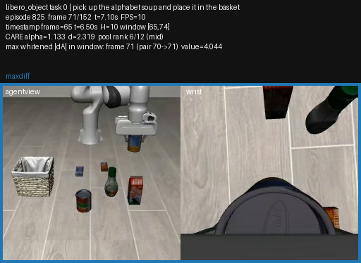

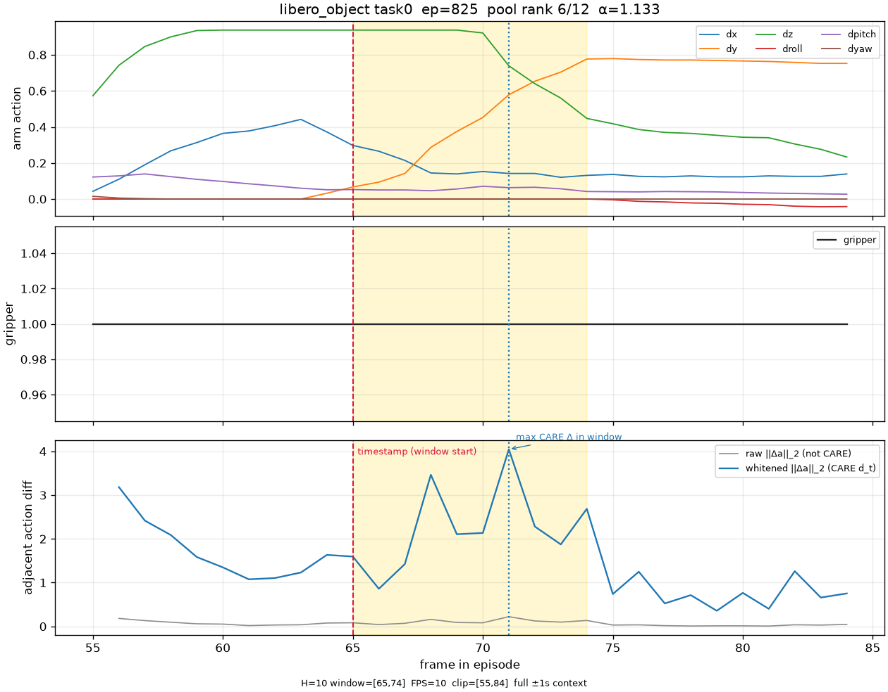

### low — lowest α in pool (rank 12/12)

- episode `945`, timestamp frame `100` (t=10.00s), length `154`
- CARE α=`0.214`, d_whitened=`0.439`
- scoring window H=10: frames `100`–`109`
- max whitened adjacent diff **inside the window**: frame `106` (pair `105`→`106`), value `0.972`

[video](object_task0_low/clip.mp4) · still at max-Δ: 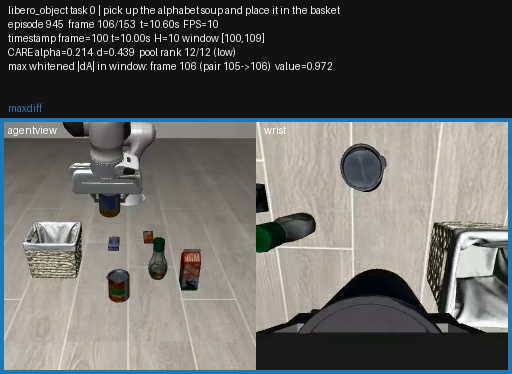

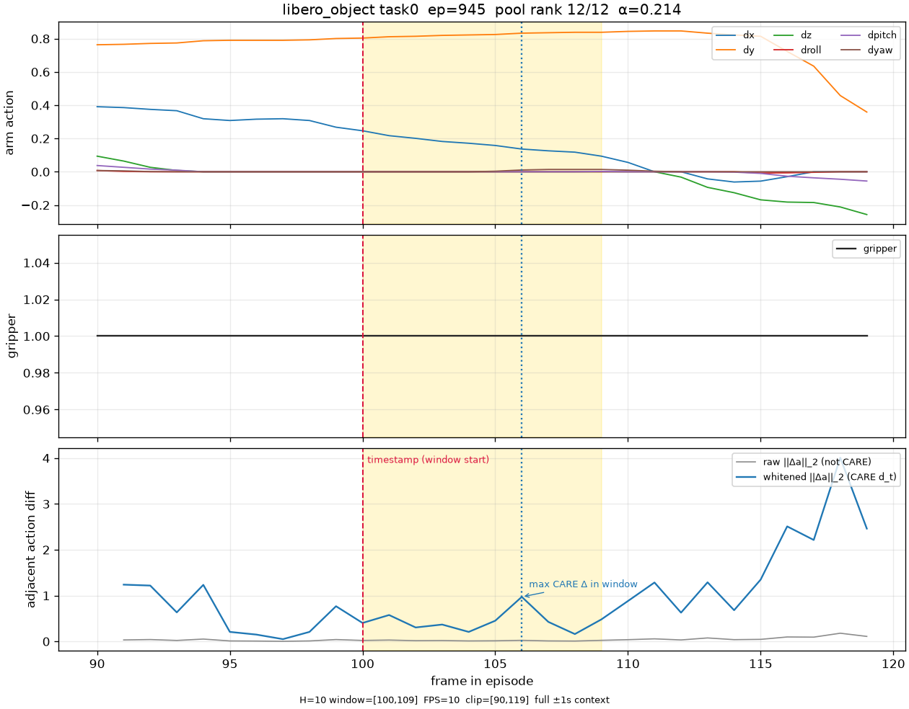

## libero_goal · task 0

Instruction: `open the middle drawer of the cabinet`

Dataset `task_index`=19. 12 CARE v2 timestamps in this task's pool.

| pick | pool rank | α | d_whitened | episode | timestamp frame | window | max-Δ frame | clip | notes |
|---|---:|---:|---:|---:|---:|---|---:|---|---|
| high | 1/12 | 1.517 | 3.106 | 497 | 88 | [88, 97] | 92 | `goal_task0_high/clip.mp4` | full ±1s |
| mid | 6/12 | 1.091 | 2.234 | 779 | 52 | [52, 61] | 59 | `goal_task0_mid/clip.mp4` | full ±1s |
| low | 12/12 | 0.169 | 0.347 | 780 | 97 | [97, 106] | 98 | `goal_task0_low/clip.mp4` | full ±1s |

### high — highest α in pool (rank 1/12)

- episode `497`, timestamp frame `88` (t=8.80s), length `128`
- CARE α=`1.517`, d_whitened=`3.106`
- scoring window H=10: frames `88`–`97`
- max whitened adjacent diff **inside the window**: frame `92` (pair `91`→`92`), value `5.097`

[video](goal_task0_high/clip.mp4) · still at max-Δ: 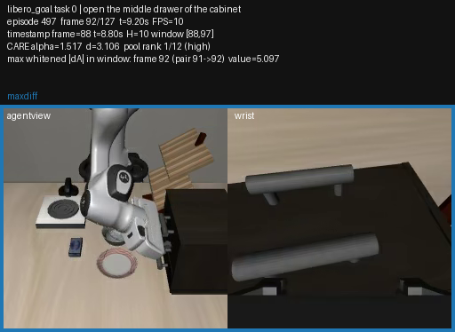

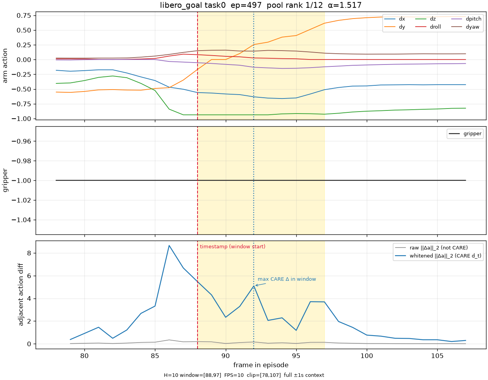

### mid — closest to pool median α (rank 6/12)

- episode `779`, timestamp frame `52` (t=5.20s), length `126`
- CARE α=`1.091`, d_whitened=`2.234`
- scoring window H=10: frames `52`–`61`
- max whitened adjacent diff **inside the window**: frame `59` (pair `58`→`59`), value `3.259`

[video](goal_task0_mid/clip.mp4) · still at max-Δ: 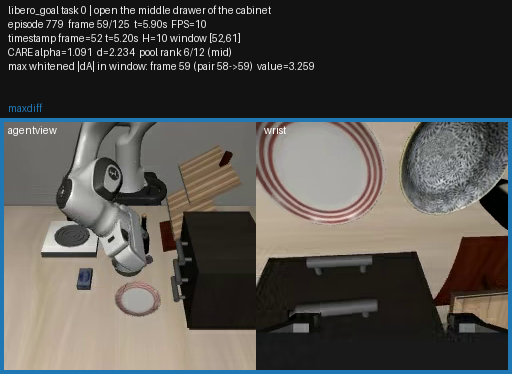

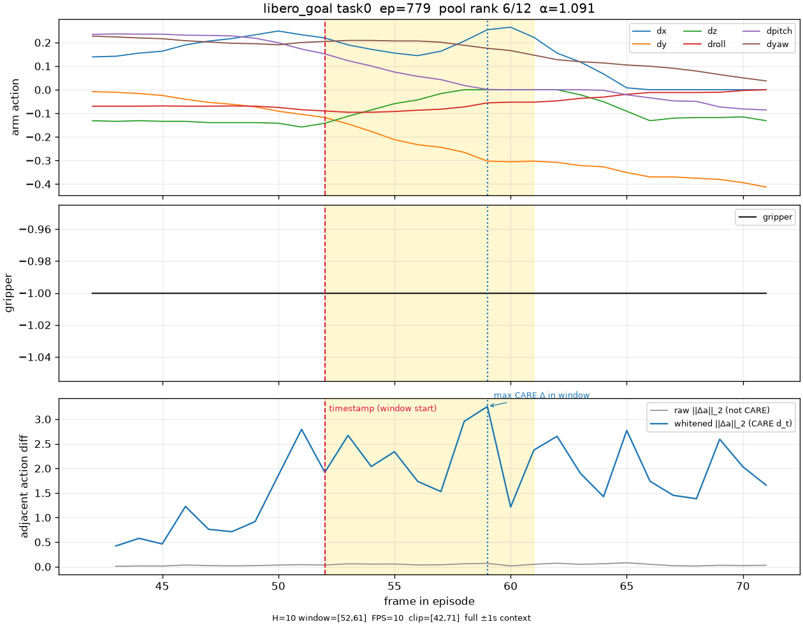

### low — lowest α in pool (rank 12/12)

- episode `780`, timestamp frame `97` (t=9.70s), length `121`
- CARE α=`0.169`, d_whitened=`0.347`
- scoring window H=10: frames `97`–`106`
- max whitened adjacent diff **inside the window**: frame `98` (pair `97`→`98`), value `0.517`

[video](goal_task0_low/clip.mp4) · still at max-Δ: 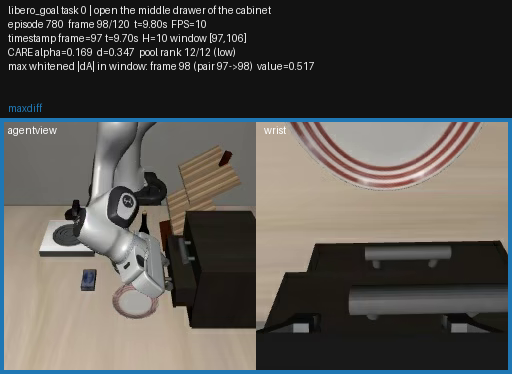

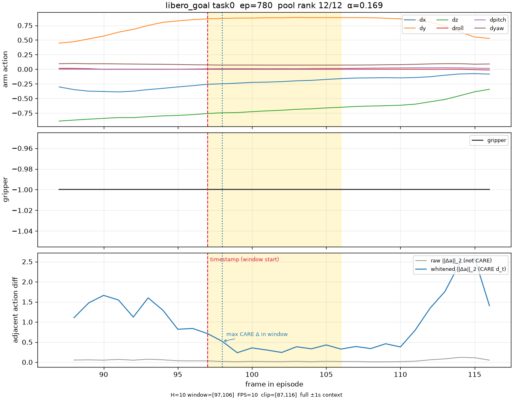

## libero_10 · task 0

Instruction: `put both the alphabet soup and the tomato sauce in the basket`

Dataset `task_index`=5. 12 CARE v2 timestamps in this task's pool.

| pick | pool rank | α | d_whitened | episode | timestamp frame | window | max-Δ frame | clip | notes |
|---|---:|---:|---:|---:|---:|---|---:|---|---|
| high | 1/12 | 1.804 | 3.693 | 156 | 213 | [213, 222] | 218 | `long_task0_high/clip.mp4` | full ±1s |
| mid | 6/12 | 0.734 | 1.503 | 340 | 271 | [271, 280] | 279 | `long_task0_mid/clip.mp4` | post-context truncated: requested 10 frames (1s at 10 FPS), got 1 |
| low | 12/12 | 0.290 | 0.594 | 317 | 1 | [1, 10] | 10 | `long_task0_low/clip.mp4` | pre-context truncated: requested 10 frames (1s at 10 FPS), got 1 |

### high — highest α in pool (rank 1/12)

- episode `156`, timestamp frame `213` (t=21.30s), length `255`
- CARE α=`1.804`, d_whitened=`3.693`
- scoring window H=10: frames `213`–`222`
- max whitened adjacent diff **inside the window**: frame `218` (pair `217`→`218`), value `6.604`

[video](long_task0_high/clip.mp4) · still at max-Δ: 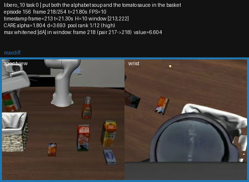

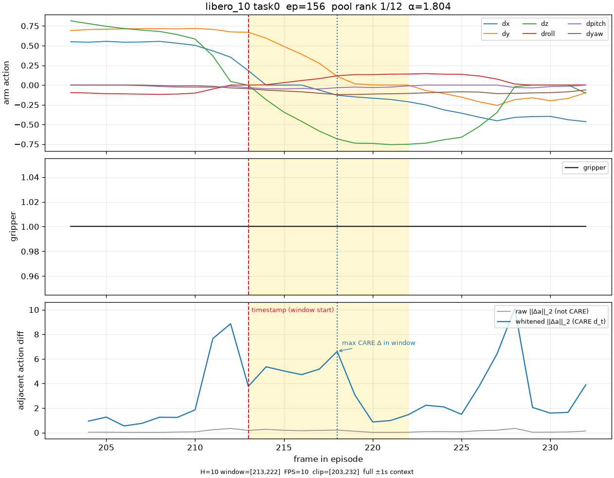

### mid — closest to pool median α (rank 6/12)

- episode `340`, timestamp frame `271` (t=27.10s), length `282`
- CARE α=`0.734`, d_whitened=`1.503`
- scoring window H=10: frames `271`–`280`
- max whitened adjacent diff **inside the window**: frame `279` (pair `278`→`279`), value `2.205`

[video](long_task0_mid/clip.mp4) · still at max-Δ: 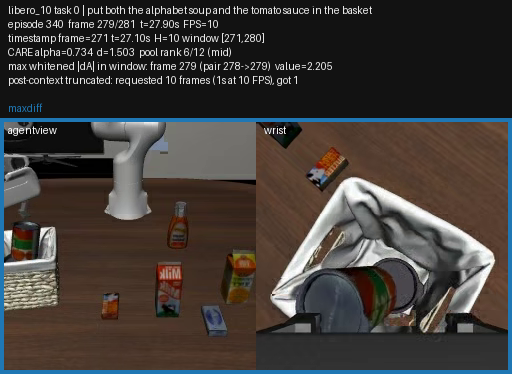

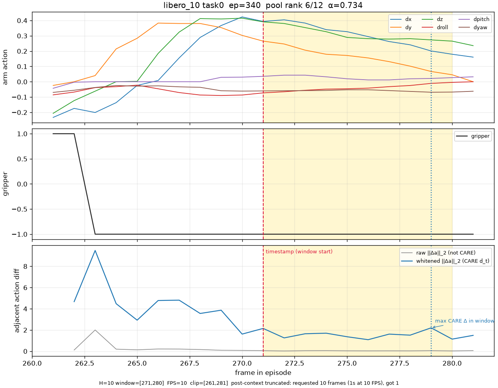

### low — lowest α in pool (rank 12/12)

- episode `317`, timestamp frame `1` (t=0.10s), length `300`
- CARE α=`0.290`, d_whitened=`0.594`
- scoring window H=10: frames `1`–`10`
- max whitened adjacent diff **inside the window**: frame `10` (pair `9`→`10`), value `2.784`

[video](long_task0_low/clip.mp4) · still at max-Δ: 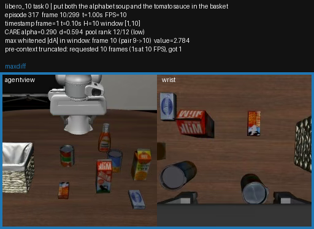

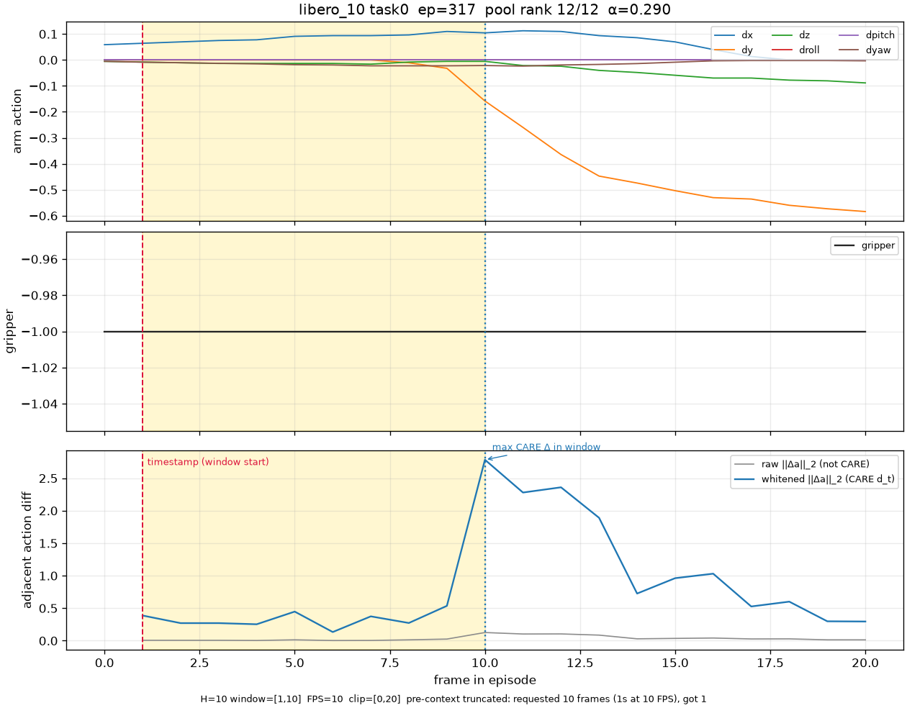

